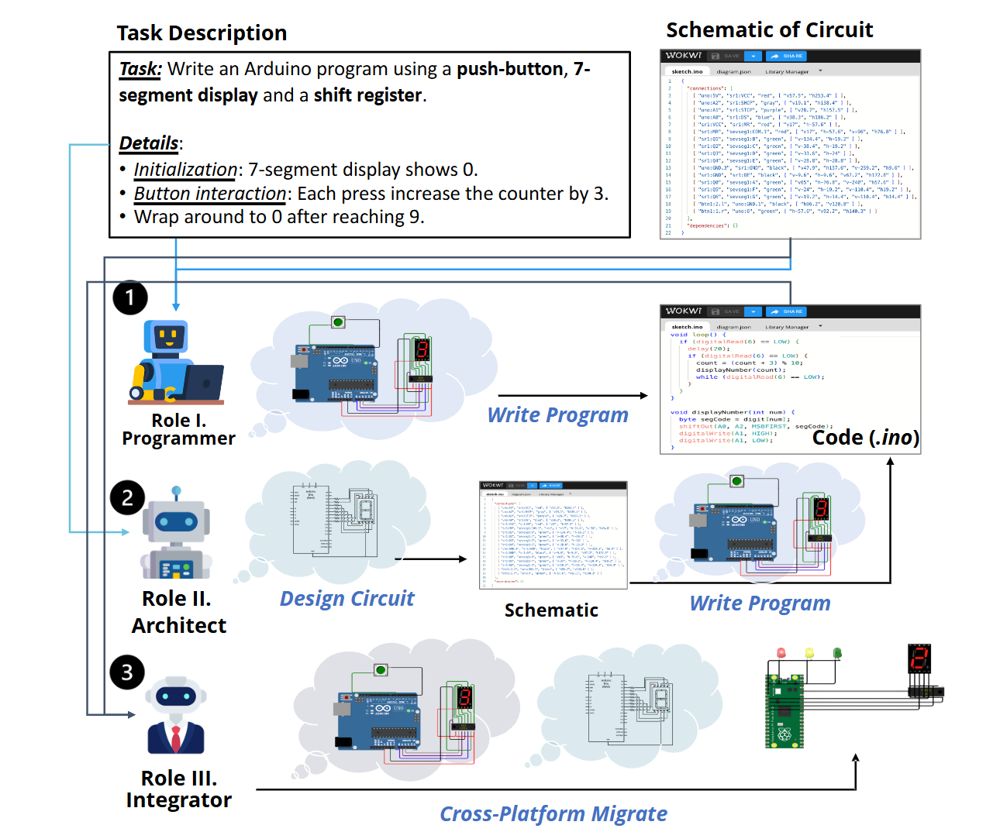

<p align="center">
<h1 align="center">EmbedAgent: Benchmarking Large Language Models

in Embedded System Development</h1>

<p align="center">
    <a href="https://huggingface.co/datasets/xhwl/EmbedBench"></a>
    <a href="https://arxiv.org/abs/2506.11003"></a>
</p>

# Dataset Description
EmbedBench is a benchmark for evaluating large language models (LLMs) in embedded system development. It covers end-to-end tasks including embedded programming, circuit design, and cross-platform migration across Arduino, ESP32, and Raspberry Pi Pico. EmbedBench contains 126 manually constructed cases with automated, hardware-driven validation based on virtual circuit simulation, enabling reliable assessment of how well LLMs bridge software reasoning and physical device behavior.



# Usage
## Dataset
The EmbedBench dataset is located at `./dataset/EmbedBench.json`

The data fields are as follows:

| Field | Description |
| --- | --- |
| `id` | The unique identifier for each case |
| `problem` | The problem description |
| `diagram` | The golden diagram of the circuit |
| `sketch` | The golden code |
| `test` | The test case to verify the correctness of the code |

## Eval
The evaluation prompt and script is located at `./eval/infer` and the detail result of each LLMs evaluated in our paper is located at `./eval/result`.

You can use the simulate platform [Wokwi](https://wokwi.com/) to evaluate the benchmark. 
## Citation
```
@article{xu2025embedagent,
  title={EmbedAgent: Benchmarking Large Language Models in Embedded System Development},
  author={Xu, Ruiyang and Cao, Jialun and Wu, Mingyuan and Zhong, Wenliang and Lu, Yaojie and He, Ben and Han, Xianpei and Cheung, Shing-Chi and Sun, Le},
  journal={arXiv preprint arXiv:2506.11003},
  year={2025}
}
```